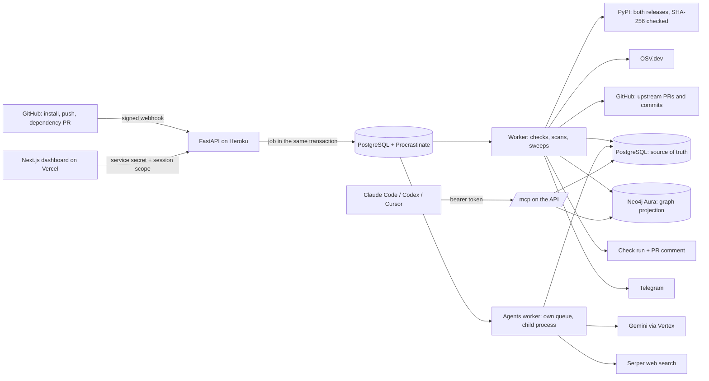
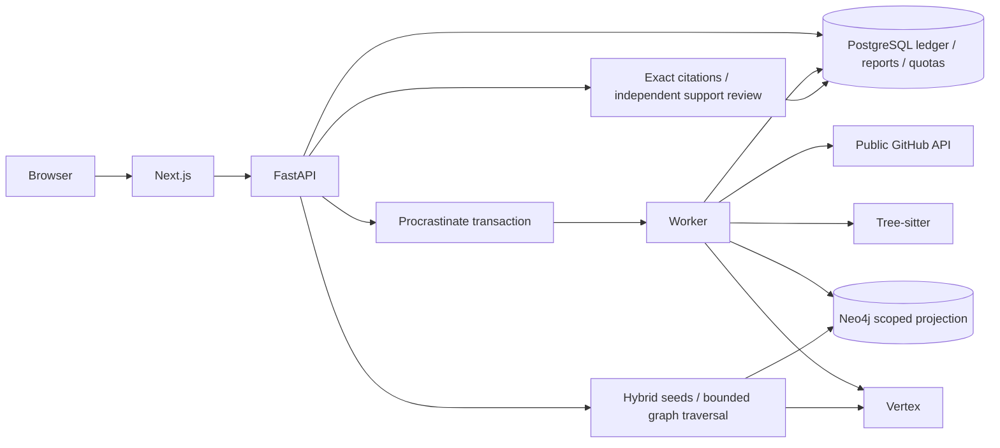

# Architecture

CodeIntent is a GitHub App. The PR check and comment are the product. Telegram pushes the findings,
the MCP server lets AI agents pull them, and the Next.js web app handles sign-in, setup and the
dashboard.

## Components

## Flows

**Install or default-branch push → scan.** For every repository the installation can access:

- read the manifests and locks;
- map the code (`codemap.py`, standard-library `ast`): files, local imports, functions, calls that can
  be resolved statically, tests, routes and console scripts;
- record every line that uses each dependency (LibCST);
- check each locked dependency against its latest release ("Before you upgrade") and against OSV.

The code map is stored in `code_maps` and projected into Neo4j (`workspace_graph.project_map`), which
also removes nodes the new map no longer has. Each scan runs one at a time in a spawned child process
to stay within the dyno's memory.

**Dependency PR → verdict.** `github_app.py` verifies the HMAC signature and ignores repeated
deliveries, then queues `analyze_pull_request`. The worker:

1. reads which declarations changed (`upgrades/manifests`);
2. finds the repository's uses of each package (`upgrades/usage`);
3. downloads both releases from PyPI, verifying their hashes (`releases.py`, `artifacts.py`);
4. compares the API surface the code uses, old against new, with griffe in static mode (`surface.py`);
5. looks up advisories (`advisories.py`), and the upstream PR and commit behind each change
   (`upstream.py`);
6. decides the verdict (`verdict.py`): `breaks` | `needs-change` | `no-known-impact` | `not-checked`;
7. traces the result through the graph (`workspace_graph.reach` and `blast`): uses, transitive chains,
   the function containing each broken line, callers, importers, tests and entry points;
8. writes the check run and comment (`report.py`), sends the Telegram alert, and projects the run into
   Neo4j;
9. queues `review_pull` on the `agents` queue.

**Agents.** `agent/review.py` runs the patcher, the investigator and the release-notes reader in a
child process. Their validated output is stored in its own table, added to the comment in its own
section and included in `fix_brief`. `agent/news.py` runs once a day for each workspace. See
[agents.md](agents.md).

**Recovery.** PostgreSQL holds every run, verdict, scan and code map. A periodic job projects any
finished run that hasn't reached the graph, and `workspace_graph.rebuild(installation_id)` rebuilds a workspace's
graph from its runs and code maps.

## Data ownership

| Store | Holds | Notes |
| --- | --- | --- |
| PostgreSQL | installations, repositories, runs and steps, verdicts, breaks, scans, code maps, agent runs, news, MCP token digests, Telegram links, job queue | The source of truth. Each row is scoped by `installation_id`. Numbered migrations in `migrations/` |
| Neo4j | the shared ecosystem graph (`pub\|` ids) and the workspace graphs (`ws\|` ids, with `ws` = installation id) | A projection, rebuilt from PostgreSQL. See [neo4j.md](neo4j.md) |
| Worker disk | temporary repository and release downloads, the response cache | Deleted after each job; the dyno's disk doesn't persist |

## Deterministic core, agents on top

The verdict, the locations and the graph trace come from static analysis and graph traversal alone.
Agents can only add labelled context, and anything they claim is checked by code first:

- quotes must appear in the source the agent read;
- an edit must match the file, and CodeIntent analyses the patched copy again;
- news needs a page the agent actually read.

An agent can't change a verdict, post anything, or write anywhere.

## Legacy: investigation workspace

CodeIntent began as a tool for investigating why a codebase took its current shape, from its PRs,
reviews, issues and commits. It still runs at `/investigate`. The rest of this document describes
that feature.

### Ownership

PostgreSQL owns immutable repository snapshots, collection coverage, source hashes, imported decisions, stage checkpoints, reports, usage counters and job state. A corpus is stored as bounded JSONB inside an immutable index row. Neo4j is a projection, not the sole copy of evidence. There is no cross-database transaction: a pending ledger record is written first, the graph is projected, then a PostgreSQL transaction publishes the index. Failed graph writes never move the repository's ready pointer.

Queue submission and the import ledger row use the same PostgreSQL transaction through Procrastinate's external connection interface. This removes the enqueue/outbox gap. Repository locks serialize competing workers, while an active-import unique index and advisory lock make duplicate submissions idempotent.

An index manifest includes repository/revision, full captured source records and provenance, deterministic links, coverage, parser policy, model identities and decision policy. Equal symbol names in different files/revisions do not establish identity. Explicit GitHub rename metadata creates file lineage; only uniquely resolved calls in the same file get CALLS edges. This is deliberately narrower than whole-program type resolution.

### Retrieval

Each immutable graph scope has separate full-text and 768-dimensional vector indexes, preventing other repositories from consuming its nearest-neighbour slots. The official Neo4j HybridCypherRetriever selects hybrid seeds, then parameterized Cypher follows an allowlist of evidence relationships for up to two hops. All nodes and relationships on a path must belong to the same index. Authorship alone does not expand the evidence neighbourhood.

The graph path uses four hybrid seeds and up to 14 evidence sources. The comparison baseline uses up to 14 hybrid results without expansion. Both cap source count at 14 before timeline evidence is attached. Exact context sizes and retrieved IDs are available in evaluation output; these are bounded retrieval observations, not proof of universal graph superiority.

User text is tokenized into literal Lucene terms while its original text supplies the embedding and the question. Neither user nor model output becomes arbitrary Cypher or a shell command. Repository code is parsed as data, never installed, imported or executed.

### Answers

Captured source text is partitioned into short addressable spans before generation. The model returns span IDs; the server binds original text and offsets. It verifies bundle membership, matching original characters and evidence-state invariants. One bounded repair is permitted for malformed references. A separate Vertex support review then removes claims whose cited passage/context does not support the complete claim. A failed review withholds the answer.

This checks provenance and provides a second semantic filter; it remains fallible. Inference is explicitly labelled. Partial support includes unknowns, and an insufficient answer cannot assert claims. Current behavior cannot be established by a historical comment alone. Source timestamps, merge outcomes, captured times, indexed revision and report generation time remain distinct.

Validated results are persisted with model/policy/index identity. Permanent report URLs and JSON exports refer to that stored result. New questions from an archived report remain scoped to its displayed index rather than silently moving to a newer revision.

### Decision history

Model-extracted decisions require exact passages from the relevant PR or its children and a literal subject present in cited text. Outcome is derived from captured merge metadata. A qualified replacement needs the same subject/aspect, overlapping changed paths, a later merged change and explicit replacement language; it stays labelled as inferred.

A separate deterministic path identifies unique declaration deletions/additions from merged diffs on the same exact file/symbol. A later declaration restoration can replace that declaration-presence aspect. It does not prove public export, implementation equivalence or a complete rollback. The HTTPX fixture exercises this distinction for `httpx/_urls.py::raw`.

### Trust boundary (investigation workspace)

This is one public workspace. Imports require a signed, expiring operator session; the server forwards an operator secret only after validating it. API routes also require the separate web-to-API service secret. Origin checks protect state-changing browser requests. All imported repositories must be public github.com repositories; arbitrary hosts and private repositories are rejected. Public reports contain public source data.

Private repositories, GitHub OAuth, tenant accounts, complete historical call graphs, calibrated confidence scores, automatic code modifications and arbitrary external-tool execution are outside this release.
