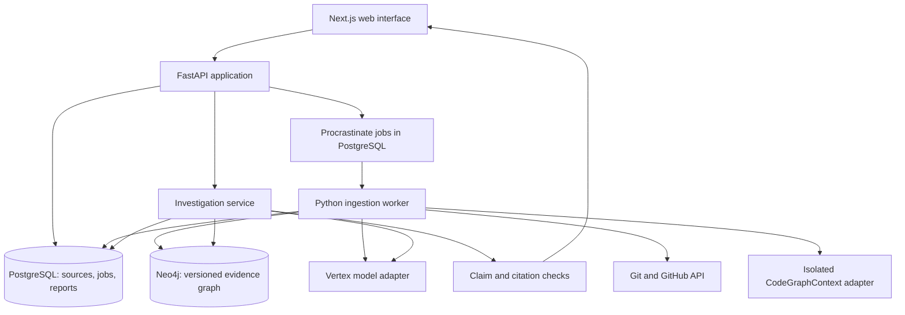

# Code Intent: product and engineering plan

Status: proposed implementation baseline, 1 November 2026.

## 1. Product promise

A developer can point to a piece of code, ask why it exists, and inspect the recorded decisions behind it, including later changes that replaced an earlier decision.

The unit of value is an investigation with supported claims, original evidence, dates, and explicit limits. The primary audiences are engineers joining a project, maintainers revisiting old decisions, and teams transferring ownership.

The T1.1 brief calls for public-repository history, connected decisions, historical supersession, and honest handling of missing evidence. These become acceptance criteria rather than marketing claims. [Original brief](https://docs.google.com/document/d/1Mz0ZNAIF2jphS6SKA_X0hcHa-ZW0ioqYtZ81hBMvqMQ/edit).

### Initial scope

- Public GitHub repositories; Python is the first fully exercised language.
- One substantial demonstration repository with years of history, a declared subsystem/history scope, and several verified decision stories.
- Current code at a pinned revision plus relevant historical source and diff snapshots. Selected release comparisons are supported once their source snapshots have been ingested.
- Commits, PR bodies, issue comments, PR reviews and inline review comments, linked issues, and design documents stored in the repository.
- Natural-language investigations, source inspection, decision chronology, and a focused relationship view.
- Genuine repository import through an operator/local workflow. The public demo opens a ready repository immediately; unrestricted anonymous imports are a later operational decision.
- Saved read-only investigations for public data, with the index revision visible.

### Expansion after the core release

Private-repository access, organization accounts, additional verified languages, webhooks, broad cross-repository reasoning, arbitrary historical checkouts, editor integration, desktop packaging, and Sarvam language support. These receive separate gates rather than becoming hidden dependencies of the first demonstration.

## 2. Experience contract

### Primary journey

Landing page -> open a real investigation -> ask a question -> inspect a claim -> open the original evidence -> examine a later decision -> continue with a follow-up.

The public visitor reaches the prepared repository without a login wall. Repository import is a separate path because indexing is real work with real duration. Progress reflects completed stages and observed counts, with partial coverage visible.

### Required surfaces

| Surface | Required behaviour |
| --- | --- |
| Landing | A precise promise, a real product interaction, an immediate route to the live demo, method and limits, source credits |
| Repository setup | Canonical GitHub URL, selected revision/scope, validation, anticipated constraints, real indexing stages, retry/cancel |
| Investigation workspace | Question composer, answer with per-claim citations, current repository/revision, follow-ups, useful history |
| Evidence inspector | Exact passage or diff, source identity and timestamp, code/source links, relationship path, source coverage |
| Decision chronology | Earlier/current decisions in their actual scope; superseded or conflicting states distinguished |
| Focused graph | Only the evidence neighbourhood relevant to the active investigation; equivalent accessible list |
| Index details | Data collected, excluded or failed; source-update time; snapshot revision; ingestion state |
| Public investigation link | Stable read-only report with public evidence and a clear snapshot label |

Every surface includes useful empty, loading, partial, failed, retry, and keyboard states where applicable. Mobile landing and shared reports are first-class; the dense desktop workspace reflows into tabs and a source sheet.

## 3. Open-source reuse policy

Use a library when it provides the capability we need. Keep our product-specific logic small and explicit. The detailed ownership map is in [reuse-map.md](./reuse-map.md).

Preferred order: supported public APIs, an adapter around a pinned upstream component, then a narrowly vendored module with licence/provenance and regression tests. A full fork is reserved for a demonstrated integration need.

The irreducible product work is the decision model, evidence linking, scoped temporal logic, answer support checks, coverage accounting, and the user experience. No reviewed repository has yet demonstrated that it supplies all of these end to end.

We will maintain an inventory of packages and copied files, upstream revisions, licences, modifications, and notices. No percentage of reused code is promised before implementation. Reusing more overlapping frameworks is not a quality measure.

## 4. Proposed architecture



### Components and boundaries

- **Frontend:** Next.js and TypeScript. Use accessible shadcn components, project-owned tokens, a source/diff viewer, and lazy-loaded React Flow for the focused graph. Motion is reserved for navigation and evidence interactions.
- **API:** FastAPI and Pydantic contracts. It owns authorization, repository/index scope, investigation orchestration, and stable response/event schemas.
- **Worker:** resumable ingestion and extraction in a separate process. CPU-heavy parsing and large Git operations never block an API request.
- **PostgreSQL:** canonical metadata and source snapshots, job state/checkpoints, model/extractor versions, saved investigations and evaluation runs. Store bounded source text/JSON here initially; introduce object storage only when measured volume requires it.
- **Queue:** Procrastinate, using the existing PostgreSQL service. Its retries and locks are reused; our tasks still need idempotency and checkpoint design. No separate Redis service is required for this plan.
- **Neo4j:** an index-specific graph projection of source-backed relationships and decision assertions. Local Neo4j for development; validate the same schema against Aura before hosted release. Confirm the deployed tier supports every chosen index/query feature.
- **Models:** the official Google Gen AI SDK behind our Vertex adapter. Validate the account's actual generation, structured-output, and embedding capabilities before choosing model IDs. Use explicit provider configuration; a failed Vertex request never silently switches credentials or providers.

CodeGraphContext currently brings broad parser/database dependencies, and some useful entry points are internal. Its integration is provisional. First test a pinned indexer in an isolated environment; reuse parsing and call resolution through a normalized output adapter. Do not import its entire runtime into the API or expose its configuration and graph deletion operations to visitors. See the fallback in the reuse map.

### Proposed repository structure

```text
apps/web/                  landing, workbench, shared reports
services/api/              HTTP contracts, auth, orchestration
services/worker/           ingestion and extraction tasks
packages/domain/           evidence, decisions, support policies
packages/integrations/     GitHub, Git, indexer, Neo4j, Vertex
packages/contracts/        generated API client and shared schemas
evals/                     labelled questions and ablation runner
infra/                     compose, container builds, deployment config
docs/                      decisions, operations, source attribution
planning/                  this planning package
```

Python domain/integration packages are shared by API and worker. Dependency isolation may require a dedicated indexer image; the integration spike decides this. Generate TypeScript clients from the API schema rather than maintaining two incompatible definitions.

## 5. Ingestion and evidence model

### Pipeline

1. Canonicalize an allowed public GitHub repository and resolve its numeric repository ID, default branch, and target commit.
2. Create an index manifest with selected paths, history range, supported languages, quotas, and extractor versions.
3. Fetch code/history without running the target repository. Do not install its dependencies, run hooks, recurse into submodules, or execute build scripts.
4. Extract files, symbols, imports and calls. Store revision-scoped identities and source locations.
5. Mine relevant Git changes with PyDriller and Git rename/blame/history tools. Fetch associated PRs/issues and all relevant comment/review pages, recording incomplete responses.
6. Persist immutable source snapshots and original URLs before using a model. Record GitHub document IDs, edit timestamps, content hashes, and retrieval time. Edited comments create new snapshot versions.
7. Resolve deterministic links: commit-to-PR associations, explicit issue references, changed files/lines, and author/reviewer identities.
8. Extract candidate decisions and alternatives using a typed schema and exact supporting spans. Model suggestions begin as assertions with provenance, not unquestioned facts.
9. Resolve relevant code aliases/renames and scoped supersession candidates. Validate them against source and implemented changes.
10. Project verified and qualified assertions into Neo4j. Publish the index only after validation; keep the previous ready index available during refresh.

### Canonical entities

Repository, IndexRun, Revision, FileVersion, SymbolVersion, ConfigKey, Commit, PullRequest, DiscussionEntry, Issue, DesignDocument, Person, DecisionAssertion, EvidenceSpan, and optional Incident.

Every node and relationship is scoped to the repository and index. A symbol identity includes repository, revision, path, kind, qualified name and location; a stable lineage identifier is assigned only when a supported mapping exists. Equal names alone never prove identity.

Core relationships include CONTAINS, CALLS, IMPORTS, MODIFIES, ASSOCIATED_WITH_PR, DISCUSSES, RESOLVES, AUTHORED_BY, REVIEWED_BY, SUPPORTED_BY, IMPLEMENTS, RENAMED_TO, SUPERSEDES, and CONTRADICTS.

Every asserted relationship carries source IDs/spans, extraction method, extractor version, scope and support category. A linked issue becomes an incident only when the source establishes incident context. An author or reviewer is not automatically the present owner or person responsible for a failure.

### Temporal rules

- Separate source/event time, merge time, ingestion time, and the code revision being examined.
- A merged change is different from a proposal, review suggestion, or rejected alternative.
- A later timestamp does not prove supersession. Decisions must concern the same subject and overlapping conditions, and a source-backed replacement or implementation change must support the relationship.
- A decision may be superseded only in one aspect, version range, platform, or configuration. Retain the unaffected parts.
- Contradictory evidence stays visible when it cannot be reconciled. Do not select the newest sentence merely because it is newer.
- Historical questions cite the selected historical sources. Current behaviour is claimed only when confirmed against the indexed code revision.
- First support explicit, high-confidence reversals and deprecations. Broader implicit temporal inference expands only with evaluation evidence.

## 6. Investigation and answer contract

### Query path

Resolve repository/revision -> identify named symbols and decision topics -> retrieve lexical/semantic candidates -> traverse relevant source relationships -> apply scope and temporal rules -> build an evidence bundle -> compose a typed answer -> validate claims/citations -> deliver the supported result.

Retrieval uses both code anchors and text. Graph traversal must add actual evidence relationships; a graph-shaped decoration around vector-search results does not satisfy the product.

Start with bounded, parameterized Cypher templates for the supported investigation types and official retriever components where useful. User input and model output do not become arbitrary executable Cypher or shell commands.

### Structured result

- Investigation ID and query, repository/index/revision identity, source manifest version.
- A brief answer composed of individually cited claims.
- For each claim: supporting spans, support category, relevant scope, temporal status, and any contradiction.
- Decision timeline and the small relationship subgraph used for the answer.
- Relevant participants with precise roles and source attribution.
- Coverage limits and explicit unknowns.
- Model/retrieval/validation versions stored internally for reproducibility.

Evidence categories are **direct**, **inferred**, **conflicting**, and **insufficient**. Temporal status is a separate field. These are evidence assessments, not calibrated probabilities; do not show invented confidence percentages.

### Claim checks

Check that every cited ID belongs to the requested index, that the stored source span exists, that quotes/diffs match the snapshot, and that the cited material is relevant to the claim. Unsupported clauses are removed, narrowed or marked unknown. An additional semantic-support check can help but remains fallible; human-labelled evaluations test it.

Stream real progress events and already-validated answer units. Do not stream unsupported prose and attempt to repair its citations afterwards. Display useful stages such as finding code, following discussions, checking later changes, and assembling evidence only when those operations actually occur. Do not expose or fabricate internal chain-of-thought.

If Vertex is unavailable, existing source inspection and ready reports remain usable. Show the provider failure truthfully and allow retry. Previously generated reports show their saved timestamp and model/index version.

## 7. Reliability and operational requirements

### Persistence and recovery

- Retryable tasks use idempotent keys and staged checkpoints. At-least-once task execution must not duplicate graph assertions or source records.
- PostgreSQL is the authoritative source ledger; Neo4j is a rebuildable projection. A manifest/outbox records pending graph writes because there is no cross-database atomic transaction.
- A failed or cancelled ingestion never appears complete. Preserve partial source counts and actionable error categories.
- Concurrency locks prevent two refreshes from publishing competing states. A disconnected browser does not cancel a server job by accident.
- SSE events have sequence IDs and reconnect/replay support; polling is an acceptable recovery path.
- Cache identity includes repository/index manifest, source content hashes, question/context, prompt/policy version, and model version. Changed evidence invalidates affected reports/caches.

### Boundaries directly relevant to this app

- Vertex credentials stay in server-side runtime configuration. Use a local credential-file reference during development and an appropriate secret/identity mechanism in hosting. Never place service-account JSON in the browser, Git, public files, container layers, screenshots or logs.
- Public demo users read prepared public data and receive bounded query quotas. Repository imports require an operator/owner session initially. Publicly shared reports contain public sources only.
- Validate allowed clone destinations, repository paths, size/depth/time limits, and network targets. No arbitrary URL fetcher or shell interpolation.
- Treat repository documents and issue comments as data. Embedded instructions cannot request tools, credential access, external transmissions, or policy changes.
- Sanitize rendered Markdown/HTML and validate external links. Query endpoints are read-only with repository/index authorization; ingestion credentials have a separate scope.
- Enforce per-job token/concurrency limits, cancellation, and backpressure. The user's flexible testing budget permits meaningful validation; it does not require uncontrolled jobs.

### Observability

Request/job/investigation IDs connect logs and traces. Record collection completeness, queue delay, stage duration, source count, model usage, retries, query duration and citation-check outcomes. Logs exclude credentials and avoid dumping full raw source payloads by default.

Record actual usage during Vertex tests. Cost estimates are derived only from verified model pricing and observed usage. No pricing, performance or savings claim is established by this plan.

### Hosting proposal

Keep the first deploy portable: a web service, API service and long-running worker, managed PostgreSQL, and Neo4j Aura. Confirm the chosen worker platform supports the indexer's process, memory, storage and task duration before choosing a host. Do not place repository indexing inside a short-lived frontend/serverless request.

Docker Compose provides the local path; managed-service configuration provides the hosted path. Exact hosts/tiers follow the measured feasibility run and available accounts. Deployment includes migrations, health/readiness checks, rollback, source-ledger backup and an index rebuild procedure.

## 8. Delivery sequence and gates

There is no fixed date. Each gate produces concrete evidence and a reviewable result. Useful tasks may overlap after their interfaces are clear; foundational failures are resolved before expanding scope.

| Gate | Deliverable | Exit condition |
| --- | --- | --- |
| A. Evidence and integration feasibility | Demo-source dossier, pinned reuse inventory, minimal Vertex generation/structured-output/embedding checks, indexer-to-Neo4j spike | A real source can be collected, linked to changed code, retrieved, and cited; dependency/isolation decisions are supported by a runnable result |
| B. Product and art direction | Final scope, navigation, real copy, tokens, landing/workbench studies and state designs | The user can review the chosen visual language and complete journey before broad UI implementation |
| C. One working investigation | Persisted source -> graph -> validated live answer -> source inspector | One complete real case works through the actual backend; repeated/paraphrased questions are supported |
| D. Core history engine | Durable imports, entity aliases, decisions, scoped supersession, abstention | A known reversal and an evidence gap both behave correctly; jobs resume after interruption |
| E. Complete product experience | Landing, import, workbench, citations, chronology, focused graph, saved public reports | Real data flows through every main surface; no dead controls or fabricated progress |
| F. Evaluation and hardening | Labelled benchmark, retrieval ablation, recovery and isolation checks, visual/browser review | The release criteria below pass; measured limitations are written down |
| G. Deployment and demo | Healthy hosted app, reproducible local setup, rehearsal, recording and handoff | A fresh browser can use it; another machine can run the documented path; deployed provider calls are verified |

### Release acceptance criteria

These are targets, not achieved results.

- Establish a 30-question benchmark: 10 supported rationale questions, 6 supersession/version questions, 6 missing-evidence questions, 4 entity/rename questions, and 4 conflicting/misleading-context questions. Split development and held-out evaluation before tuning.
- All displayed citations resolve to the correct snapshot and source location. No cross-repository/index evidence leakage in isolation tests.
- All curated supersession cases avoid presenting the dead decision as current. Every curated missing-evidence case explicitly acknowledges the gap.
- At least 90% of factual rationale claims in the benchmark are supported by their cited spans under human review. Report recall and refusal rate alongside this, so blanket refusal cannot pass.
- At least 80% of answerable held-out questions obtain the essential evidence and a useful supported answer. Any revised threshold is documented before the final evaluation.
- At least one live case recovers rationale beyond what the repository's current documentation provides; at least one traversal materially contributes a necessary evidence link.
- Run an ablation using the same corpus, model, question set and comparable context-token budget with text retrieval only. Publish observed differences and failures; do not promise graph superiority before measurement.
- A restarted worker resumes safely; repeated imports do not duplicate entities; upstream rate limits and model failures produce honest recoverable states.
- Provisional UX targets: source inspection after data load within 300 ms; meaningful progress feedback within 1 second; warm investigation first validated content within 8 seconds and completion within 20 seconds at p95. Benchmark at a stated load; adjust architecture or state the limit if these are missed.
- Keyboard navigation, focus restoration, readable source/diff views, reduced motion and no clipped controls at 360, 768, 1280 and 1440 px. Target WCAG 2.2 AA with automated checks plus manual review.
- Tests cover domain invariants, real Postgres/Neo4j integration, contract compatibility, browser journeys and a small actual Vertex smoke suite. Repeated live calls are reserved for provider behaviour, prompt changes and release checks.
- Deployed migrations, health checks, primary Vertex calls, source links and cold entry are verified separately from local tests.

## 9. Decisions still to prove

1. Does CodeGraphContext supply a sufficiently stable parsing/resolution seam with acceptable dependencies? If not, can a narrowly extracted MIT module or direct Tree-sitter adapter satisfy the same fixture tests?
2. Which Vertex model/region/embedding dimensions work in the user's project? What are their measured latency and usage characteristics?
3. Does the demonstration corpus contain enough explicit rationale and reversals to pass the benchmark, including a question the docs alone cannot answer?
4. What source-history limit offers useful answers within measured indexing resources? Show that limit rather than imply full coverage.
5. Can the chosen Aura tier execute our schema and scoped queries as designed? Verify locally and remotely.
6. Which hosting environment accommodates the worker's measured needs? Freeze this after the spike, before deployment work.

No unresolved technical question requires the user to choose a library speculatively. Resolve them with a bounded spike and record the result.
